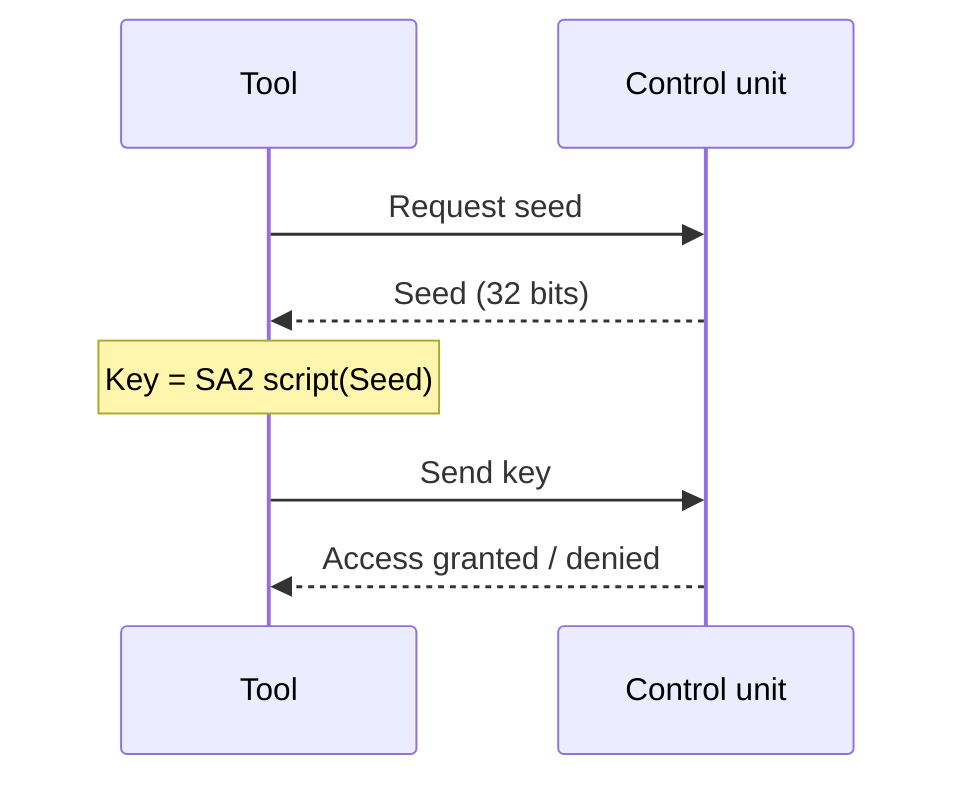
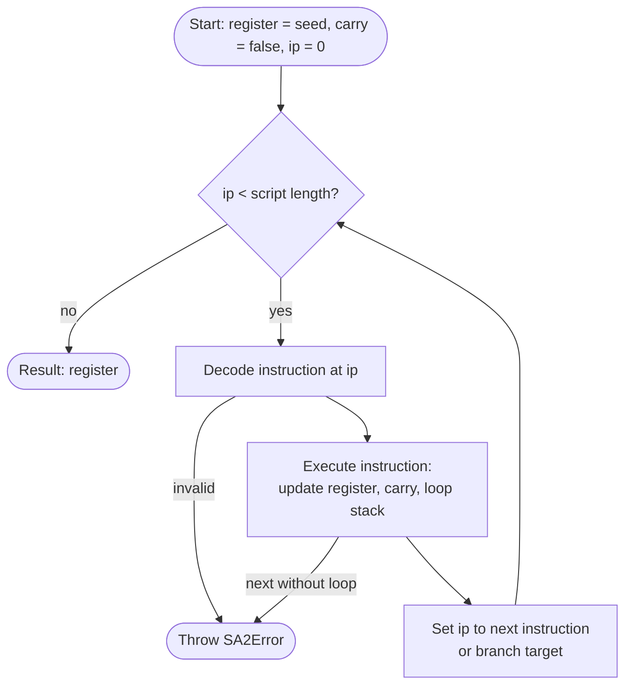
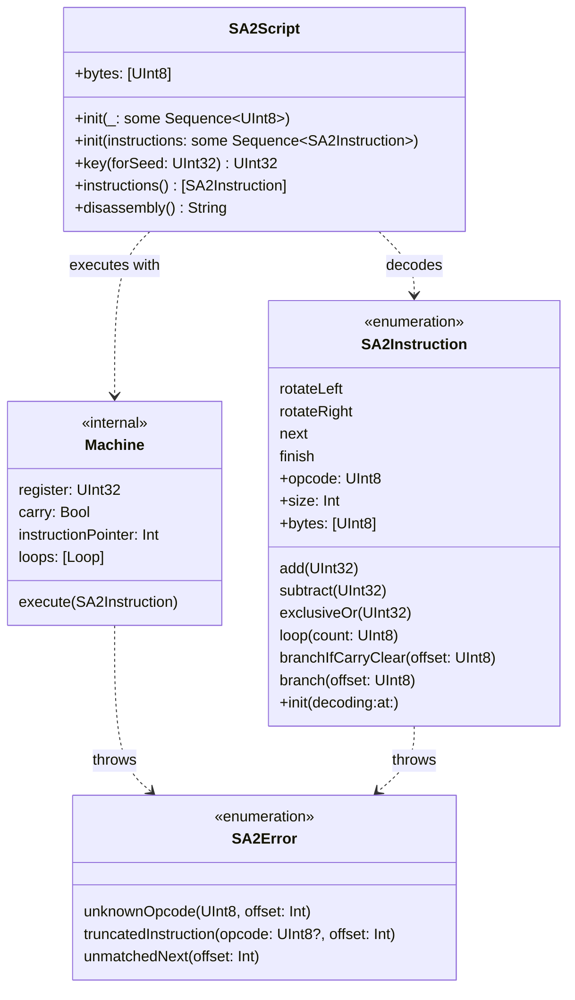

# SA2SeedKey – Algorithm and Data Types

🇬🇧 English · [🇩🇪 Deutsch](SA2SeedKey.de.md)

This document is intended for developers who want to use, extend or review the package. It
describes the virtual machine that executes an SA2 script, the instruction set and the public
Swift types.

## Contents

1. [Background](#1-background)
2. [The Virtual Machine](#2-the-virtual-machine)
3. [Instruction Set](#3-instruction-set)
4. [Execution Flow](#4-execution-flow)
5. [Step-by-Step Example](#5-step-by-step-example)
6. [Data Types](#6-data-types)
7. [Error Handling](#7-error-handling)
8. [Differences from the Python Original](#8-differences-from-the-python-original)
9. [Extending the Instruction Set](#9-extending-the-instruction-set)

---

## 1. Background

Before a diagnostic or flashing tool may reprogram a Volkswagen Group control unit, it has to
authenticate itself (UDS service *Security Access*, `0x27`):



The rule for computing the key is not hard-coded in the tool. It is shipped as a small bytecode
program – the **SA2 script** – inside the FRF or ODX flash container of the respective control
unit. This package contains the interpreter for that bytecode.

## 2. The Virtual Machine

The machine is deliberately minimal. Its entire state consists of:

| State               | Swift (`SA2Script.Machine`) | Type             | Initial value | Meaning                                                 |
| ------------------- | --------------------------- | ---------------- | ------------- | ------------------------------------------------------- |
| Register            | `register`                  | `UInt32`         | Seed          | The only working register; holds the key at the end     |
| Carry flag          | `carry`                     | `Bool`           | `false`       | Set by rotation, addition and subtraction               |
| Instruction pointer | `instructionPointer`        | `Int`            | `0`           | Byte offset of the next instruction in the script       |
| Loop stack          | `loops`                     | `[Loop]`         | empty         | Open loops, innermost on top                            |

An entry on the loop stack (`Loop`) stores

- `bodyStart` – the byte offset of the first instruction in the loop body, and
- `remainingIterations` – how many *additional* times the body will run.

There is no memory, there are no further registers, and there are no backward jumps except via
`next`.

## 3. Instruction Set

Every instruction starts with an opcode byte, followed by 0, 1 or 4 operand bytes. 32-bit operands
are encoded **big-endian** (most significant byte first).

| Opcode | Mnemonic | `SA2Instruction`               | Size | Effect on the register          | Carry flag                      |
| ------ | -------- | ------------------------------ | ---- | ------------------------------- | ------------------------------- |
| `0x81` | `rsl`    | `.rotateLeft`                  | 1    | `r = r << 1 \| r >> 31`         | = previous bit 31               |
| `0x82` | `rsr`    | `.rotateRight`                 | 1    | `r = r >> 1 \| r << 31`         | = previous bit 0                |
| `0x93` | `add`    | `.add(UInt32)`                 | 5    | `r = (r + v) mod 2³²`           | = overflow                      |
| `0x84` | `sub`    | `.subtract(UInt32)`            | 5    | `r = (r − v) mod 2³²`           | = underflow (`r < v`)           |
| `0x87` | `eor`    | `.exclusiveOr(UInt32)`         | 5    | `r = r ^ v`                     | unchanged                       |
| `0x68` | `for`    | `.loop(count:)`                | 2    | –                               | unchanged                       |
| `0x49` | `next`   | `.next`                        | 1    | –                               | unchanged                       |
| `0x4A` | `bcc`    | `.branchIfCarryClear(offset:)` | 2    | –                               | read                            |
| `0x6B` | `bra`    | `.branch(offset:)`             | 2    | –                               | unchanged                       |
| `0x4C` | `finish` | `.finish`                      | 1    | –                               | unchanged                       |

### Details

**Rotation (`rsl`, `rsr`).** This is a plain rotation, not a rotation *through* the carry flag: the
bit shifted out is reinserted on the other side *and* additionally copied into the carry flag. A
previously set carry flag has no influence.

**Addition and subtraction.** The result is computed modulo 2³². The carry flag indicates whether
an overflow (addition) or underflow (subtraction) occurred. In Swift this corresponds exactly to
`addingReportingOverflow(_:)` and `subtractingReportingOverflow(_:)`.

**Loops (`for n` … `next`).** `for n` pushes an entry with `bodyStart` = the offset directly after
the `for` instruction and `remainingIterations = n − 1`. On `next`:

- `remainingIterations > 0` → decrement the counter, jump back to `bodyStart`.
- otherwise → pop the entry and continue with the instruction after `next`.

The body therefore runs exactly `n` times. Special case `n = 0`: the counter is −1, and the body
still runs **once**. Loops may be nested; `next` always belongs to the innermost open loop.

**Branches (`bcc`, `bra`).** The operand is an unsigned distance in bytes, measured from the end
of the branch instruction. The target is therefore `offset of branch + 2 + operand`. Branches can
thus only go forward. `bcc` ("branch if carry clear") only jumps if the carry flag is **not** set;
otherwise execution continues with the next instruction. Typical use: a following `eor`
instruction (5 bytes) is skipped with `bcc +5` if the preceding addition did not overflow.

**End (`finish`).** `finish` changes nothing and does **not** halt the machine; the instruction
pointer merely advances by one byte. In practice `finish` is placed at the end of the script, so
nothing follows anyway. The machine stops as soon as the instruction pointer reaches or passes the
end of the script.

## 4. Execution Flow

`SA2Script.key(forSeed:)` does not decode the instructions up front. Instead, it decodes each
instruction at the position the instruction pointer currently points to. This is necessary because
branches may land on arbitrary byte offsets.



In pseudocode:

```text
register ← seed; carry ← false; ip ← 0; loops ← []
while ip < length(script):
    instruction ← decode(script, ip)
    next_ip ← ip + size(instruction)
    match instruction:
        rsl:   carry ← bit31(register); register ← rotl(register, 1)
        rsr:   carry ← bit0(register);  register ← rotr(register, 1)
        add v: (register, carry) ← register + v   (mod 2³², overflow)
        sub v: (register, carry) ← register − v   (mod 2³², underflow)
        eor v: register ← register xor v
        for n: loops.push(bodyStart: next_ip, remaining: n − 1)
        next:  if loops.top.remaining > 0:
                   loops.top.remaining −= 1; next_ip ← loops.top.bodyStart
               else:
                   loops.pop()
        bcc o: if not carry: next_ip ← next_ip + o
        bra o: next_ip ← next_ip + o
        finish: –
    ip ← next_ip
return register
```

**Termination.** Every script terminates after a finite number of steps: branches only go forward,
and the only backward jump (`next`) is bounded by a counter that decreases on every jump. A timeout
or step limit is therefore not required.

## 5. Step-by-Step Example

Script (31 bytes) from the tests, seed `0x1A1B1C1D`:

```text
Pos  Bytes                Instruction
  0  68 02                for 2
  2  81                   rsl
  3  49                   next
  4  93 A5 5A 55 AA       add 0xA55A55AA
  9  4A 05                bcc +5
 11  87 81 05 95 26       eor 0x81059526
 16  68 05                for 5
 18  82                   rsr
 19  49                   next
 20  84 5A A5 AA 55       sub 0x5AA5AA55
 25  87 03 F7 80 6A       eor 0x03F7806A
 30  4C                   finish
```

Trace (register and carry flag *after* each instruction):

| Step | ip | Instruction        | Register     | Carry | next ip |
| ---: | -: | ------------------ | ------------ | :---: | ------: |
|    1 |  0 | `for 2`            | `0x1A1B1C1D` |   0   |       2 |
|    2 |  2 | `rsl`              | `0x3436383A` |   0   |       3 |
|    3 |  3 | `next`             | `0x3436383A` |   0   |       2 |
|    4 |  2 | `rsl`              | `0x686C7074` |   0   |       3 |
|    5 |  3 | `next`             | `0x686C7074` |   0   |       4 |
|    6 |  4 | `add 0xA55A55AA`   | `0x0DC6C61E` |   1   |       9 |
|    7 |  9 | `bcc +5`           | `0x0DC6C61E` |   1   |      11 |
|    8 | 11 | `eor 0x81059526`   | `0x8CC35338` |   1   |      16 |
|    9 | 16 | `for 5`            | `0x8CC35338` |   1   |      18 |
|   10 | 18 | `rsr`              | `0x4661A99C` |   0   |      19 |
|   11 | 19 | `next`             | `0x4661A99C` |   0   |      18 |
|   12 | 18 | `rsr`              | `0x2330D4CE` |   0   |      19 |
|   13 | 19 | `next`             | `0x2330D4CE` |   0   |      18 |
|   14 | 18 | `rsr`              | `0x11986A67` |   0   |      19 |
|   15 | 19 | `next`             | `0x11986A67` |   0   |      18 |
|   16 | 18 | `rsr`              | `0x88CC3533` |   1   |      19 |
|   17 | 19 | `next`             | `0x88CC3533` |   1   |      18 |
|   18 | 18 | `rsr`              | `0xC4661A99` |   1   |      19 |
|   19 | 19 | `next`             | `0xC4661A99` |   1   |      20 |
|   20 | 20 | `sub 0x5AA5AA55`   | `0x69C07044` |   0   |      25 |
|   21 | 25 | `eor 0x03F7806A`   | `0x6A37F02E` |   0   |      30 |
|   22 | 30 | `finish`           | `0x6A37F02E` |   0   |      31 |

Result: key **`0x6A37F02E`**.

Steps 6 to 8 are worth noting: the addition overflows, the carry flag is set, so `bcc` does *not*
jump and the `eor` instruction is executed. With a different seed that does not overflow,
`bcc +5` would skip exactly this 5-byte `eor` instruction.

The second test script demonstrates nested loops: there, `bcc +16` at offset 3 skips an entire
inner loop (`for 4` … `next`), so the start and end of a loop are always skipped together.

## 6. Data Types

All public types are value types, `Hashable` and `Sendable`. They can therefore be safely copied,
compared and passed between threads or actors.



### `SA2Script` (`Sources/SA2SeedKey/SA2Script.swift`)

The script as immutable bytecode.

| Member                                     | Description                                                                  |
| ------------------------------------------ | ---------------------------------------------------------------------------- |
| `bytes: [UInt8]`                           | The raw bytecode.                                                            |
| `init(_ bytes: some Sequence<UInt8>)`      | From bytes, e.g. `[UInt8]`, `Data` or `ArraySlice<UInt8>`.                   |
| `init(instructions:)`                      | From a sequence of instructions; encodes each via `SA2Instruction.bytes`.    |
| Array literal                              | `let s: SA2Script = [0x81, 0x4C]` thanks to `ExpressibleByArrayLiteral`.     |
| `key(forSeed:) throws(SA2Error) -> UInt32` | Executes the script and returns the key.                                     |
| `instructions() throws(SA2Error)`          | Decodes the script linearly from start to end into `[SA2Instruction]`.      |
| `disassembly() throws(SA2Error)`           | Human-readable listing, one instruction per line (`for 2`, `rsl`, …).        |

`instructions()` reads the bytes linearly and does not follow branches. In all known scripts,
branch targets point to instruction boundaries, so this listing matches the actual program.
`key(forSeed:)` does not depend on this.

### `SA2Instruction` (`Sources/SA2SeedKey/SA2Instruction.swift`)

A single instruction as an enumeration with associated values. The operands are already decoded
(32-bit values as `UInt32`, counts and branch distances as `UInt8`).

| Member                                    | Description                                                           |
| ----------------------------------------- | --------------------------------------------------------------------- |
| `opcode: UInt8`                           | The opcode byte.                                                      |
| `size: Int`                               | Length in bytes including the opcode (1, 2 or 5).                     |
| `bytes: [UInt8]`                          | Encoded form; 32-bit operands big-endian.                             |
| `init(decoding:at:) throws(SA2Error)`     | Decodes an instruction at a byte offset (must not be negative).       |
| `description`                             | Mnemonic as in the original, e.g. `add 0xA55A55AA` or `bcc +5`.       |

Encoding and decoding are inverse to each other:
`SA2Script(instructions: try script.instructions()) == script` holds for every valid script
(covered by the test `roundTripsInstructions`).

### `SA2Error` (`Sources/SA2SeedKey/SA2Error.swift`)

See [section 7](#7-error-handling).

### `SA2Script.Machine` (internal)

Holds the state described in [section 2](#2-the-virtual-machine) and executes exactly one
instruction per call to `execute(_:)`. A new machine is created as a local variable for every call
to `key(forSeed:)`; there is no shared mutable state. The type is intentionally not public so that
the implementation can change without breaking the interface.

### Thread Safety

An `SA2Script` can be used by any number of threads or tasks concurrently without locking:

- **No shared mutable state.** `SA2Script`, `SA2Instruction` and `SA2Error` are value types
  without mutable properties; the bytecode is stored in `let bytes: [UInt8]`. The package contains
  no classes and no global or static variables.
- **One machine per call.** Register, carry flag, instruction pointer and loop stack only exist as
  a local `Machine` inside `key(forSeed:)`.
- **Checked by the compiler.** The package is compiled in the Swift 6 language mode, which detects
  data races at compile time. All public types are `Sendable`.
- **Checked at runtime.** The test `isThreadSafe` runs both test scripts 1,000 times in parallel.
  On Linux, CI additionally runs the tests with the Thread Sanitizer
  (`swift test --sanitize=thread`), which reports data races during execution.

One limitation: `SA2Instruction.init(decoding:at:)` accepts any `Collection<UInt8>`. If a custom,
class-based collection is passed that another thread mutates at the same time, synchronization is
the caller's responsibility. This does not apply to `[UInt8]`, `Data` or `SA2Script`, since they
are copied on mutation.

## 7. Error Handling

All throwing methods use *typed throws* (`throws(SA2Error)`). Inside the `catch` block, `error` is
therefore already of type `SA2Error`, and the compiler checks a `switch` over it for
exhaustiveness:

```swift
do {
    let key = try script.key(forSeed: seed)
    // …
} catch {
    switch error {
    case let .unknownOpcode(opcode, offset):
        // unknown byte in the script
    case let .truncatedInstruction(opcode, offset):
        // script ends in the middle of an instruction
    case let .unmatchedNext(offset):
        // `next` without an open loop
    }
}
```

| Case                                                 | Error                                            |
| ---------------------------------------------------- | ------------------------------------------------ |
| Byte at the instruction offset is not a known opcode | `.unknownOpcode(opcode, offset:)`                |
| Operands extend past the end of the script           | `.truncatedInstruction(opcode: opcode, offset:)` |
| `init(decoding:at:)` with an offset past the end     | `.truncatedInstruction(opcode: nil, offset:)`    |
| `next` without an open loop                          | `.unmatchedNext(offset:)`                        |

`offset` is always the byte offset of the affected instruction. `SA2Error` conforms to
`CustomStringConvertible` and provides a readable message, e.g. `Unknown opcode 0xFF at offset 1`.

The following are *not* errors:

- a branch past the end of the script – execution then ends normally;
- a loop still open at the end – the stack is simply discarded;
- an empty script – the key then equals the seed.

This behavior matches the Python original.

## 8. Differences from the Python Original

The computed result is identical for all valid scripts; this was verified with the original's test
vectors and with 300 randomly generated scripts. The differences are limited to how state and
errors are handled:

| Topic                        | Python (`Sa2SeedKey`)                                                   | Swift (`SA2Script`)                                     |
| ---------------------------- | ----------------------------------------------------------------------- | ------------------------------------------------------- |
| Object model                 | Mutable class, seed passed to the constructor                           | Immutable value type, seed passed as a parameter        |
| Repeated execution           | A second `execute()` call does not recompute, returns the old register  | Every call recomputes from scratch                      |
| Loop stack                   | Class attribute, shared by **all** instances                            | Local to each execution                                 |
| Concurrency                  | Not thread-safe                                                         | `Sendable`, can be used in parallel freely              |
| Carry flag                   | `int` (0, 1 or `0x80000000`)                                            | `Bool`                                                  |
| Register                     | Arbitrary-precision `int`, masked after operations                      | `UInt32`, overflow via `…ReportingOverflow`             |
| Unknown opcode               | `KeyError`                                                              | `SA2Error.unknownOpcode`                                |
| Truncated instruction        | `IndexError`                                                            | `SA2Error.truncatedInstruction`                         |
| `next` without a loop        | `IndexError`                                                            | `SA2Error.unmatchedNext`                                |
| Disassembler                 | –                                                                       | `instructions()`, `disassembly()`                       |

## 9. Extending the Instruction Set

A new instruction has to be added in four places:

1. a new `case` in `SA2Instruction` with a documentation comment (opcode, effect);
2. `opcode`, `size`, `bytes` and `description` in `SA2Instruction`;
3. the `switch` in `init(decoding:at:)`;
4. the `switch` in `SA2Script.Machine.execute(_:)`.

Since all `switch` statements are exhaustive, the compiler reports every place that was missed
except item 3 (there, a missing opcode ends up in the `default` branch). New instructions should
be covered by a test in `Tests/SA2SeedKeyTests/SA2ScriptTests.swift`, ideally with a test vector
from a real flash container.

Running the tests:

```sh
swift test
```
