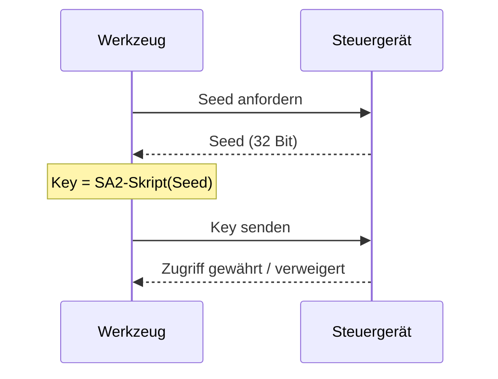
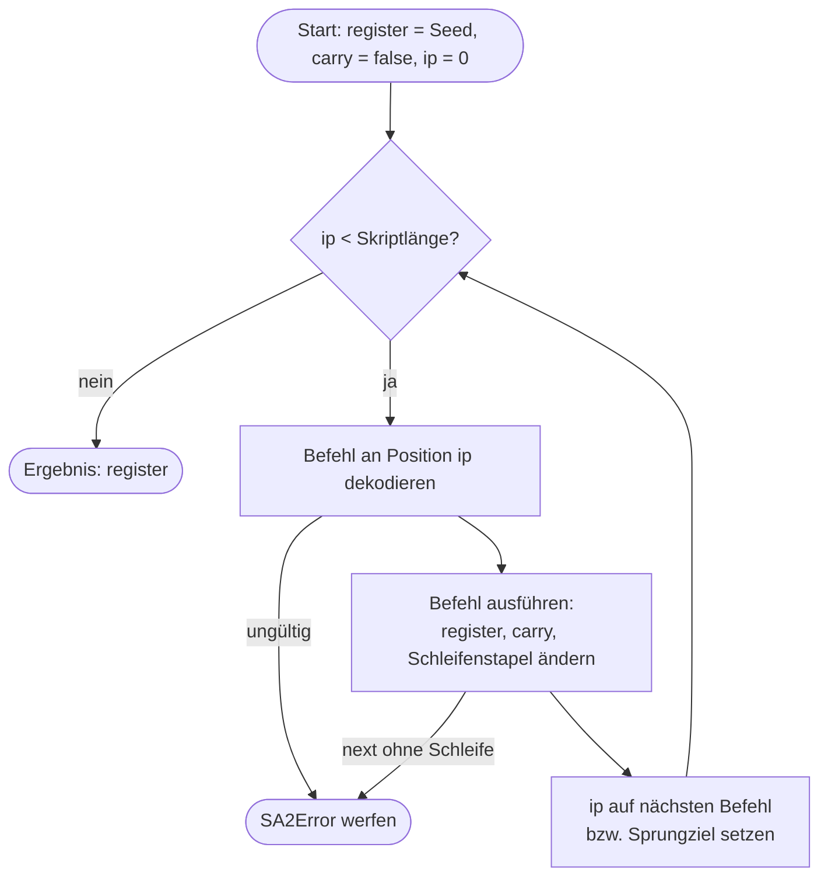
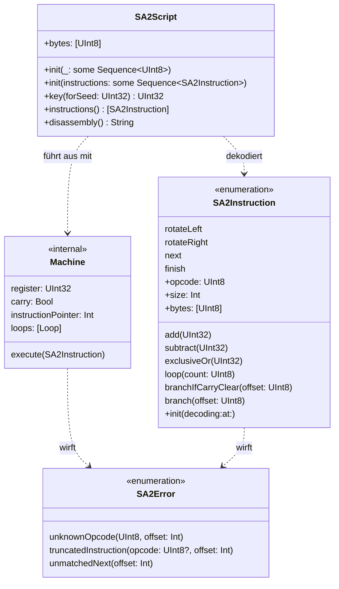

# SA2SeedKey – Algorithmus und Datentypen

Dieses Dokument richtet sich an Entwickler, die das Package verwenden, erweitern oder prüfen
möchten. Es beschreibt die virtuelle Maschine, die ein SA2-Skript ausführt, den Befehlssatz und
die öffentlichen Swift-Typen.

## Inhalt

1. [Hintergrund](#1-hintergrund)
2. [Die virtuelle Maschine](#2-die-virtuelle-maschine)
3. [Befehlssatz](#3-befehlssatz)
4. [Ausführungsablauf](#4-ausführungsablauf)
5. [Beispiel Schritt für Schritt](#5-beispiel-schritt-für-schritt)
6. [Datentypen](#6-datentypen)
7. [Fehlerbehandlung](#7-fehlerbehandlung)
8. [Abweichungen vom Python-Original](#8-abweichungen-vom-python-original)
9. [Hinweise zur Erweiterung](#9-hinweise-zur-erweiterung)

---

## 1. Hintergrund

Bevor ein Diagnose- oder Flash-Werkzeug ein Steuergerät des Volkswagen-Konzerns umprogrammieren
darf, muss es sich ausweisen (UDS-Dienst *Security Access*, `0x27`):



Die Rechenvorschrift für den Key ist nicht fest im Werkzeug hinterlegt. Sie steckt als kleines
Bytecode-Programm – das **SA2-Skript** – im FRF- bzw. ODX-Flash-Container des jeweiligen
Steuergeräts. Dieses Package enthält den Interpreter für diesen Bytecode.

## 2. Die virtuelle Maschine

Die Maschine ist bewusst minimal. Ihr gesamter Zustand besteht aus:

| Zustand            | Swift (`SA2Script.Machine`) | Typ              | Anfangswert | Bedeutung                                              |
| ------------------ | --------------------------- | ---------------- | ----------- | ------------------------------------------------------ |
| Register           | `register`                  | `UInt32`         | Seed        | Einziges Rechenregister; am Ende steht hier der Key    |
| Übertragsbit       | `carry`                     | `Bool`           | `false`     | Wird von Rotation, Addition und Subtraktion gesetzt    |
| Befehlszeiger      | `instructionPointer`        | `Int`            | `0`         | Byte-Position des nächsten Befehls im Skript           |
| Schleifenstapel    | `loops`                     | `[Loop]`         | leer        | Offene Schleifen, innerste zuoberst                    |

Ein Eintrag im Schleifenstapel (`Loop`) merkt sich

- `bodyStart` – die Byte-Position des ersten Befehls im Schleifenrumpf und
- `remainingIterations` – wie oft der Rumpf noch *zusätzlich* durchlaufen wird.

Es gibt keinen Speicher, keine weiteren Register und keine Rückwärtssprünge außer über `next`.

## 3. Befehlssatz

Jeder Befehl beginnt mit einem Opcode-Byte, gefolgt von 0, 1 oder 4 Operanden-Bytes.
32-Bit-Operanden sind **Big-Endian** kodiert (höchstwertiges Byte zuerst).

| Opcode | Mnemonik | `SA2Instruction`               | Größe | Wirkung auf das Register        | Übertragsbit                    |
| ------ | -------- | ------------------------------ | ----- | ------------------------------- | ------------------------------- |
| `0x81` | `rsl`    | `.rotateLeft`                  | 1     | `r = r << 1 \| r >> 31`         | = altes Bit 31                  |
| `0x82` | `rsr`    | `.rotateRight`                 | 1     | `r = r >> 1 \| r << 31`         | = altes Bit 0                   |
| `0x93` | `add`    | `.add(UInt32)`                 | 5     | `r = (r + v) mod 2³²`           | = Überlauf                      |
| `0x84` | `sub`    | `.subtract(UInt32)`            | 5     | `r = (r − v) mod 2³²`           | = Unterlauf (`r < v`)           |
| `0x87` | `eor`    | `.exclusiveOr(UInt32)`         | 5     | `r = r ^ v`                     | unverändert                     |
| `0x68` | `for`    | `.loop(count:)`                | 2     | –                               | unverändert                     |
| `0x49` | `next`   | `.next`                        | 1     | –                               | unverändert                     |
| `0x4A` | `bcc`    | `.branchIfCarryClear(offset:)` | 2     | –                               | wird gelesen                    |
| `0x6B` | `bra`    | `.branch(offset:)`             | 2     | –                               | unverändert                     |
| `0x4C` | `finish` | `.finish`                      | 1     | –                               | unverändert                     |

### Einzelheiten

**Rotation (`rsl`, `rsr`).** Es handelt sich um eine echte Rotation, nicht um eine Rotation *durch*
das Übertragsbit: Das herausgeschobene Bit wird auf der anderen Seite wieder eingesetzt *und*
zusätzlich ins Übertragsbit kopiert. Ein vorher gesetztes Übertragsbit fließt nicht ein.

**Addition und Subtraktion.** Das Ergebnis wird modulo 2³² gebildet. Das Übertragsbit zeigt an, ob
dabei ein Überlauf (Addition) bzw. Unterlauf (Subtraktion) stattfand. In Swift entspricht das
genau `addingReportingOverflow(_:)` und `subtractingReportingOverflow(_:)`.

**Schleifen (`for n` … `next`).** `for n` legt einen Eintrag mit `bodyStart` = Position direkt
hinter dem `for`-Befehl und `remainingIterations = n − 1` auf den Stapel. Bei `next` gilt:

- `remainingIterations > 0` → Zähler verringern, zurück zu `bodyStart` springen.
- sonst → Eintrag vom Stapel nehmen, mit dem Befehl hinter `next` fortfahren.

Der Rumpf läuft also genau `n`-mal. Sonderfall `n = 0`: Der Zähler ist dann −1, der Rumpf läuft
trotzdem **einmal**. Schleifen dürfen verschachtelt werden; `next` gehört immer zur innersten
offenen Schleife.

**Sprünge (`bcc`, `bra`).** Der Operand ist ein vorzeichenloser Abstand in Bytes, gemessen ab dem
Ende des Sprungbefehls. Ziel ist also `Position + 2 + offset`. Sprünge gehen damit ausschließlich
vorwärts. `bcc` („branch if carry clear“) springt nur, wenn das Übertragsbit **nicht** gesetzt ist,
andernfalls geht es mit dem nächsten Befehl weiter. Typische Verwendung: Ein nachfolgender
`eor`-Befehl (5 Bytes) wird mit `bcc +5` übersprungen, wenn die vorherige Addition nicht
übergelaufen ist.

**Ende (`finish`).** `finish` verändert nichts und hält die Maschine auch **nicht** an; der
Befehlszeiger rückt lediglich um ein Byte vor. In der Praxis steht `finish` am Skriptende, sodass
danach ohnehin nichts mehr folgt. Die Maschine endet, sobald der Befehlszeiger das Ende des
Skripts erreicht oder überschreitet.

## 4. Ausführungsablauf

`SA2Script.key(forSeed:)` dekodiert die Befehle nicht vorab, sondern liest jeden Befehl erst an
der Stelle, an der der Befehlszeiger gerade steht. Das ist nötig, weil Sprünge beliebige
Byte-Positionen treffen können.



In Pseudocode:

```text
register ← seed; carry ← false; ip ← 0; loops ← []
solange ip < länge(skript):
    befehl ← dekodiere(skript, ip)
    weiter ← ip + größe(befehl)
    je nach befehl:
        rsl:   carry ← bit31(register); register ← rotl(register, 1)
        rsr:   carry ← bit0(register);  register ← rotr(register, 1)
        add v: (register, carry) ← register + v   (mod 2³², Überlauf)
        sub v: (register, carry) ← register − v   (mod 2³², Unterlauf)
        eor v: register ← register xor v
        for n: loops.push(bodyStart: weiter, remaining: n − 1)
        next:  wenn loops.top.remaining > 0:
                   loops.top.remaining −= 1; weiter ← loops.top.bodyStart
               sonst:
                   loops.pop()
        bcc o: wenn nicht carry: weiter ← weiter + o
        bra o: weiter ← weiter + o
        finish: –
    ip ← weiter
ergebnis register
```

**Terminierung.** Jedes Skript endet nach endlich vielen Schritten: Sprünge gehen nur vorwärts, und
der einzige Rücksprung (`next`) ist durch einen Zähler begrenzt, der bei jedem Rücksprung sinkt.
Ein Zeitlimit oder eine Schrittbegrenzung ist daher nicht nötig.

## 5. Beispiel Schritt für Schritt

Skript (31 Bytes) aus den Tests, Seed `0x1A1B1C1D`:

```text
Pos  Bytes                Befehl
  0  68 02                for 2
  2  81                   rsl
  3  49                   next
  4  93 A5 5A 55 AA       add 0xA55A55AA
  9  4A 05                bcc +5
 11  87 81 05 95 26       eor 0x81059526
 16  68 05                for 5
 18  82                   rsr
 19  49                   next
 20  84 5A A5 AA 55       sub 0x5AA5AA55
 25  87 03 F7 80 6A       eor 0x03F7806A
 30  4C                   finish
```

Ablauf (Register und Übertragsbit *nach* dem jeweiligen Befehl):

| Schritt | ip | Befehl             | Register     | Carry | nächste ip |
| ------: | -: | ------------------ | ------------ | :---: | ---------: |
|       1 |  0 | `for 2`            | `0x1A1B1C1D` |   0   |          2 |
|       2 |  2 | `rsl`              | `0x3436383A` |   0   |          3 |
|       3 |  3 | `next`             | `0x3436383A` |   0   |          2 |
|       4 |  2 | `rsl`              | `0x686C7074` |   0   |          3 |
|       5 |  3 | `next`             | `0x686C7074` |   0   |          4 |
|       6 |  4 | `add 0xA55A55AA`   | `0x0DC6C61E` |   1   |          9 |
|       7 |  9 | `bcc +5`           | `0x0DC6C61E` |   1   |         11 |
|       8 | 11 | `eor 0x81059526`   | `0x8CC35338` |   1   |         16 |
|       9 | 16 | `for 5`            | `0x8CC35338` |   1   |         18 |
|      10 | 18 | `rsr`              | `0x4661A99C` |   0   |         19 |
|      11 | 19 | `next`             | `0x4661A99C` |   0   |         18 |
|      12 | 18 | `rsr`              | `0x2330D4CE` |   0   |         19 |
|      13 | 19 | `next`             | `0x2330D4CE` |   0   |         18 |
|      14 | 18 | `rsr`              | `0x11986A67` |   0   |         19 |
|      15 | 19 | `next`             | `0x11986A67` |   0   |         18 |
|      16 | 18 | `rsr`              | `0x88CC3533` |   1   |         19 |
|      17 | 19 | `next`             | `0x88CC3533` |   1   |         18 |
|      18 | 18 | `rsr`              | `0xC4661A99` |   1   |         19 |
|      19 | 19 | `next`             | `0xC4661A99` |   1   |         20 |
|      20 | 20 | `sub 0x5AA5AA55`   | `0x69C07044` |   0   |         25 |
|      21 | 25 | `eor 0x03F7806A`   | `0x6A37F02E` |   0   |         30 |
|      22 | 30 | `finish`           | `0x6A37F02E` |   0   |         31 |

Ergebnis: Key **`0x6A37F02E`**.

Bemerkenswert sind Schritt 6 bis 8: Die Addition läuft über, das Übertragsbit ist gesetzt, `bcc`
springt deshalb *nicht*, und der `eor`-Befehl wird ausgeführt. Bei einem anderen Seed ohne
Überlauf würde `bcc +5` genau diesen 5 Byte langen `eor`-Befehl überspringen.

Das zweite Testskript zeigt verschachtelte Schleifen: Dort überspringt `bcc +16` an Position 3 eine
komplette innere Schleife (`for 4` … `next`), sodass Schleifenbeginn und -ende immer gemeinsam
ausgelassen werden.

## 6. Datentypen

Alle öffentlichen Typen sind Werttypen, `Hashable` und `Sendable`. Sie können daher gefahrlos
kopiert, verglichen und zwischen Threads bzw. Aktoren weitergegeben werden.



### `SA2Script` (`Sources/SA2SeedKey/SA2Script.swift`)

Das Skript als unveränderlicher Bytecode.

| Mitglied                                 | Beschreibung                                                                   |
| ---------------------------------------- | ------------------------------------------------------------------------------ |
| `bytes: [UInt8]`                         | Der rohe Bytecode.                                                             |
| `init(_ bytes: some Sequence<UInt8>)`    | Aus Bytes, z. B. `[UInt8]`, `Data` oder `ArraySlice<UInt8>`.                   |
| `init(instructions:)`                    | Aus einer Befehlsfolge; kodiert jeden Befehl über `SA2Instruction.bytes`.      |
| Array-Literal                            | `let s: SA2Script = [0x81, 0x4C]` dank `ExpressibleByArrayLiteral`.            |
| `key(forSeed:) throws(SA2Error) -> UInt32` | Führt das Skript aus und liefert den Key.                                    |
| `instructions() throws(SA2Error)`        | Dekodiert das Skript linear von vorn nach hinten in `[SA2Instruction]`.        |
| `disassembly() throws(SA2Error)`         | Lesbare Darstellung, ein Befehl pro Zeile (`for 2`, `rsl`, …).                 |

`instructions()` liest die Bytes linear und folgt keinen Sprüngen. Bei allen bekannten Skripten
zeigen Sprungziele auf Befehlsgrenzen, sodass diese Darstellung dem tatsächlichen Programm
entspricht. `key(forSeed:)` hängt davon nicht ab.

### `SA2Instruction` (`Sources/SA2SeedKey/SA2Instruction.swift`)

Ein einzelner Befehl als Aufzählungstyp mit zugeordneten Werten. Die Operanden liegen bereits
dekodiert vor (32-Bit-Werte als `UInt32`, Zähler und Sprungweiten als `UInt8`).

| Mitglied                                  | Beschreibung                                                          |
| ----------------------------------------- | --------------------------------------------------------------------- |
| `opcode: UInt8`                           | Das Opcode-Byte.                                                      |
| `size: Int`                               | Länge in Bytes einschließlich Opcode (1, 2 oder 5).                   |
| `bytes: [UInt8]`                          | Kodierte Form; 32-Bit-Operanden Big-Endian.                           |
| `init(decoding:at:) throws(SA2Error)`     | Liest einen Befehl ab einer Byte-Position (nicht negativ).             |
| `description`                             | Mnemonik wie im Original, z. B. `add 0xA55A55AA` oder `bcc +5`.       |

Kodierung und Dekodierung sind zueinander invers:
`SA2Script(instructions: try script.instructions()) == script` gilt für jedes gültige Skript
(abgedeckt durch den Test `roundTripsInstructions`).

### `SA2Error` (`Sources/SA2SeedKey/SA2Error.swift`)

Siehe [Abschnitt 7](#7-fehlerbehandlung).

### `SA2Script.Machine` (intern)

Hält den in [Abschnitt 2](#2-die-virtuelle-maschine) beschriebenen Zustand und führt mit
`execute(_:)` genau einen Befehl aus. Für jeden Aufruf von `key(forSeed:)` wird eine neue Maschine
als lokale Variable angelegt; es gibt keinen gemeinsamen, veränderlichen Zustand. Der Typ ist
bewusst nicht öffentlich, damit sich die Implementierung ändern kann, ohne die Schnittstelle zu
brechen.

### Thread-Sicherheit

Ein `SA2Script` kann ohne Sperren von beliebig vielen Threads oder Tasks gleichzeitig verwendet
werden:

- **Kein gemeinsamer veränderlicher Zustand.** `SA2Script`, `SA2Instruction` und `SA2Error` sind
  Werttypen ohne veränderliche Eigenschaften; der Bytecode liegt in `let bytes: [UInt8]`. Das
  Package enthält keine Klassen und keine globalen oder statischen Variablen.
- **Eigene Maschine pro Aufruf.** Register, Übertragsbit, Befehlszeiger und Schleifenstapel
  existieren nur als lokale `Machine` innerhalb von `key(forSeed:)`.
- **Prüfung durch den Compiler.** Das Package wird im Swift-6-Sprachmodus übersetzt, der
  Datenrennen bereits beim Kompilieren erkennt. Alle öffentlichen Typen sind `Sendable`.
- **Prüfung zur Laufzeit.** Der Test `isThreadSafe` führt beide Testskripte 1.000-mal parallel
  aus. Die CI lässt die Tests unter Linux zusätzlich mit dem Thread-Sanitizer laufen
  (`swift test --sanitize=thread`), der Datenrennen während der Ausführung meldet.

Einzige Einschränkung: `SA2Instruction.init(decoding:at:)` akzeptiert jede `Collection<UInt8>`.
Wird dort eine eigene, klassenbasierte Sammlung übergeben, die ein anderer Thread gleichzeitig
verändert, liegt die Synchronisierung beim Aufrufer. Für `[UInt8]`, `Data` und `SA2Script` spielt
das keine Rolle, da diese beim Verändern kopiert werden.

## 7. Fehlerbehandlung

Alle werfenden Methoden verwenden *typed throws* (`throws(SA2Error)`). Im `catch`-Block ist
`error` daher bereits vom Typ `SA2Error`, und ein `switch` darüber wird vom Compiler auf
Vollständigkeit geprüft:

```swift
do {
    let key = try script.key(forSeed: seed)
    // …
} catch {
    switch error {
    case let .unknownOpcode(opcode, offset):
        // unbekanntes Byte im Skript
    case let .truncatedInstruction(opcode, offset):
        // Skript endet mitten in einem Befehl
    case let .unmatchedNext(offset):
        // `next` ohne offene Schleife
    }
}
```

| Fall                                                   | Fehler                                          |
| ------------------------------------------------------ | ----------------------------------------------- |
| Byte an der Befehlsposition ist kein bekannter Opcode  | `.unknownOpcode(opcode, offset:)`               |
| Operanden reichen über das Skriptende hinaus           | `.truncatedInstruction(opcode: opcode, offset:)` |
| `init(decoding:at:)` mit Position hinter dem Ende      | `.truncatedInstruction(opcode: nil, offset:)`   |
| `next`, ohne dass eine Schleife offen ist              | `.unmatchedNext(offset:)`                       |

`offset` ist stets die Byte-Position des betroffenen Befehls. `SA2Error` ist
`CustomStringConvertible` und liefert eine lesbare Meldung, z. B.
`Unknown opcode 0xFF at offset 1`.

Kein Fehler ist dagegen:

- ein Sprung hinter das Skriptende – die Ausführung endet dann regulär;
- eine am Ende noch offene Schleife – der Stapel wird einfach verworfen;
- ein leeres Skript – der Key entspricht dann dem Seed.

Dieses Verhalten entspricht dem Python-Original.

## 8. Abweichungen vom Python-Original

Das Rechenergebnis ist für alle gültigen Skripte identisch; geprüft mit den Testvektoren des
Originals und mit 300 zufällig erzeugten Skripten. Abweichungen gibt es nur im Umgang mit Zustand
und Fehlern:

| Thema                        | Python (`Sa2SeedKey`)                                                   | Swift (`SA2Script`)                                     |
| ---------------------------- | ----------------------------------------------------------------------- | ------------------------------------------------------- |
| Objektmodell                 | Veränderliche Klasse, Seed im Konstruktor                               | Unveränderlicher Werttyp, Seed als Parameter            |
| Mehrfache Ausführung         | Zweiter `execute()`-Aufruf rechnet nicht neu, liefert altes Register    | Jeder Aufruf rechnet vollständig neu                    |
| Schleifenstapel              | Klassenattribut, von **allen** Instanzen geteilt                        | Lokal pro Ausführung                                    |
| Nebenläufigkeit              | Nicht threadsicher                                                      | `Sendable`, beliebig parallel nutzbar                   |
| Übertragsbit                 | `int` (0, 1 oder `0x80000000`)                                          | `Bool`                                                  |
| Register                     | Beliebig großer `int`, nach Operationen maskiert                        | `UInt32`, Überlauf über `…ReportingOverflow`            |
| Unbekannter Opcode           | `KeyError`                                                              | `SA2Error.unknownOpcode`                                |
| Abgeschnittener Befehl       | `IndexError`                                                            | `SA2Error.truncatedInstruction`                         |
| `next` ohne Schleife         | `IndexError`                                                            | `SA2Error.unmatchedNext`                                |
| Disassembler                 | –                                                                       | `instructions()`, `disassembly()`                       |

## 9. Hinweise zur Erweiterung

Ein neuer Befehl wird an vier Stellen ergänzt:

1. neuer `case` in `SA2Instruction` mit Dokumentationskommentar (Opcode, Wirkung);
2. `opcode`, `size`, `bytes` und `description` in `SA2Instruction`;
3. der `switch` in `init(decoding:at:)`;
4. der `switch` in `SA2Script.Machine.execute(_:)`.

Da alle `switch`-Anweisungen erschöpfend sind, meldet der Compiler jede vergessene Stelle außer
Punkt 3 (dort landet ein fehlender Opcode im `default`-Zweig). Neue Befehle sollten mit einem Test
in `Tests/SA2SeedKeyTests/SA2ScriptTests.swift` abgesichert werden, idealerweise mit einem
Testvektor aus einem echten Flash-Container.

Tests ausführen:

```sh
swift test
```
